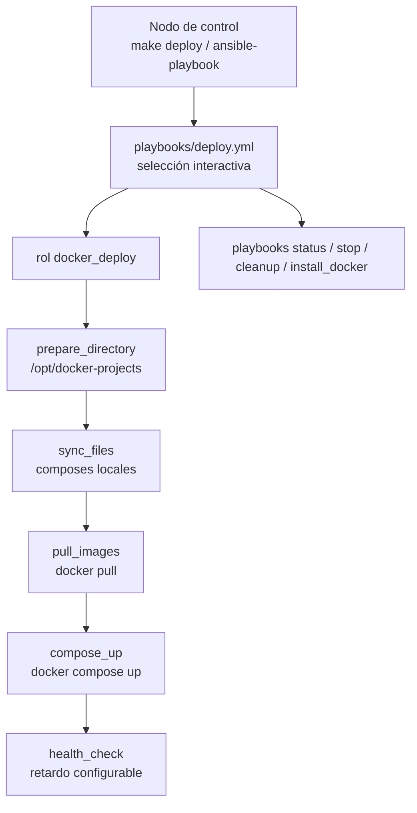

# Ansible Docker Deployer

Proyecto Ansible para despliegue interactivo de proyectos Docker Compose en máquinas Linux remotas, con selección de proyecto, verificación de estado, stop, limpieza e instalación de Docker.

## Contenido

- [Características](#características)
- [Arquitectura](#arquitectura)
- [Stack](#stack)
- [Estructura del repositorio](#estructura-del-repositorio)
- [Instalación](#instalación)
- [Uso](#uso)
- [Configuración](#configuración)
- [Roadmap](#roadmap)
- [Licencia](#licencia)

## Características

- Despliegue interactivo: el playbook `deploy.yml` ofrece selección del proyecto a desplegar.
- Soporta proyecto como archivo único (`composes/mi-app.yml`) o directorio con `docker-compose.yml` + `.env` + configs.
- Health checks tras levantar los servicios (con retardo configurable).
- Playbooks de estado, stop y limpieza de recursos Docker.
- Instalación de Docker Engine en servidores remotos.
- Variables globales centralizadas en `group_vars/all.yml`.

## Arquitectura



## Stack

- Ansible (> = 2.12)
- YAML
- Bash / Makefile
- Docker Engine y Docker Compose (plugin v2 o v1)

## Estructura del repositorio

```
ansible-docker-deployer/
├── ansible.cfg                   # Configuración global de Ansible
├── Makefile                      # make deploy / status / stop / cleanup / lint ...
├── inventory/
│   └── hosts.ini                 # Inventario de servidores
├── group_vars/
│   └── all.yml                   # Variables compartidas
├── composes/                     # Aquí van tus proyectos Docker
│   ├── mi-app/
│   │   ├── docker-compose.yml
│   │   └── .env                  (opcional)
│   └── examples/                 # nginx-example, webapp-fullstack
├── playbooks/
│   ├── deploy.yml                # Principal (selección interactiva)
│   ├── status.yml                # Estado de todos los proyectos
│   ├── stop.yml                  # Detener un proyecto
│   ├── cleanup.yml               # Limpiar recursos Docker
│   └── install_docker.yml        # Instalar Docker en los servidores
└── roles/
    └── docker_deploy/            # Rol principal de despliegue
        ├── tasks/
        ├── defaults/
        ├── handlers/
        └── templates/
```

## Instalación

Requisitos — en el controlador: Ansible >= 2.12 y Python 3.8+. En los servidores remotos: Docker Engine >= 20.10, plugin Docker Compose v2 (o docker-compose v1), Python 3.x y usuario con permisos de Docker o sudo.

```bash
git clone https://github.com/bi0punk/ansible-docker-deployer
cd ansible-docker-deployer
```

## Uso

```bash
# 1. Configurar inventario
vim inventory/hosts.ini

# 2. Añadir tus proyectos Docker en composes/

# 3. Desplegar (selección interactiva)
ansible-playbook playbooks/deploy.yml -i inventory/hosts.ini

# 4. Ver estado de los proyectos
ansible-playbook playbooks/status.yml -i inventory/hosts.ini

# 5. Detener un proyecto
ansible-playbook playbooks/stop.yml -i inventory/hosts.ini
```

También se puede usar el Makefile:

```bash
make deploy            # despliegue interactivo (o PROJECT=mi-app)
make status            # estado general
make stop              # detener un proyecto
make cleanup           # limpiar recursos no utilizados
make cleanup-all       # limpiar todo (imágenes, volúmenes, redes)
make install-docker    # instalar Docker en los servidores
make check            # verificar conectividad con los servidores
make list-projects    # listar proyectos disponibles en ./composes
make lint             # validar sintaxis de los playbooks
```

Para fijar el inventario por defecto usar `INVENTORY=inventario/custom.ini` en el comando.

## Configuración

Variables en `group_vars/all.yml`:

| Variable | Default | Descripción |
|---|---|---|
| `docker_deploy_base_path` | `/opt/docker-projects` | Ruta en el servidor remoto |
| `local_composes_path` | `{{ playbook_dir }}/../composes` | Compose locales |
| `docker_pull_always` | `true` | Pull antes de levantar |
| `docker_force_recreate` | `false` | Recrear contenedores aunque no cambien |
| `docker_remove_orphans` | `true` | Eliminar contenedores huérfanos |
| `backup_before_deploy` | `false` | Backup de volúmenes antes de desplegar |
| `deploy_health_check_delay` | `10` | Segundos antes de verificar salud |
| `docker_compose_bin` | `docker compose` | Comando de Docker Compose |
| `deploy_env` | `production` | Entorno de despliegue |

Credenciales sensibles: usar `ansible-vault encrypt_string 'mi_password_secreto' --name 'db_password'` y ejecutar con `--ask-vault-pass`.

## Roadmap

- [x] Despliegue interactivo con selección de proyecto
- [x] Health checks tras el deploy
- [x] Playbooks de status / stop / cleanup / install-docker
- [ ] Backup de volúmenes estable (experimental)
- [ ] Soporte multi-entorno por inventario (staging/production)

## Licencia

Sin archivo LICENSE declarado en el repositorio.